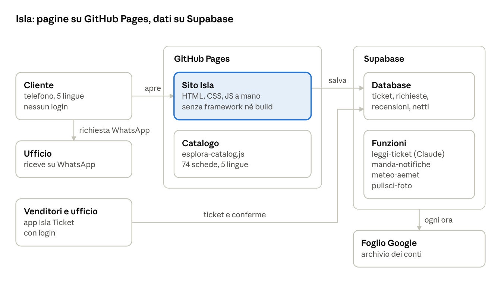

# Cos'è Isla

Aggiornato al 21 ottobre 2026 · [versione PDF](documenti/cos-e-isla.pdf)

## In breve

Isla è il sito-app di **Admiral Excursions** per vendere escursioni a Tenerife: barche, delfini e balene, Teide, parchi acquatici, buggy, quad, spettacoli, giri delle isole. Si apre dal telefono e si può installare come un'app (PWA).

Admiral è un **rivenditore**: le escursioni le fanno altre compagnie (Freebird, Royal Delfin, Shogun, Peter Pan…), e Isla le vende. Per questo le schede portano il nome della barca vera.

Le prenotazioni non sono automatiche: il cliente manda una **richiesta su WhatsApp** (+34 662 908 073), l'ufficio la conferma entro 24 ore e il pagamento si concorda dopo.

A ottobre 2026 il catalogo ha **74 schede, 67 pubblicate**, in cinque lingue: italiano, inglese, spagnolo, francese e tedesco. Il sito sta su [jacques88-sudo.github.io/isla](https://jacques88-sudo.github.io/isla/).

## Cosa vede il cliente

In alto c'è una capsula scura con cinque voci: Home · Esperienze · carrello (la lista delle richieste) · Le mie prenotazioni · Menu. Le lingue si scelgono con le bandiere.

| pagina | a cosa serve |
| --- | --- |
| Home (`index.html`) | la vetrina, e "Dicono di noi" con le recensioni |
| Esperienze (`escursioni.html`) | l'elenco delle escursioni, con filtri per zona e durata e i preferiti (♥) |
| Scheda (`tour.html`) | foto, descrizione, cosa è incluso, prezzi, varianti e "Aggiungi alla lista" |
| Pacchetti (`pacchetti.html`, `pacchetto.html`) | più escursioni insieme con lo sconto, anche "Crea il tuo pacchetto" |
| Noleggio (`noleggio.html`) | auto e moto a noleggio |
| Mappa (`mappa.html`) | le spiagge e il meteo di oggi e domani |
| Le mie prenotazioni (`booking.html`) | ticket e richieste del cliente, meteo AEMET, "Cosa portare", recensione |
| Privacy e Termini | le regole scritte per il cliente |

Tutto quello che il cliente salva (lista, preferiti) resta **nel suo telefono**, non in un account: i clienti non hanno login.

## Come si prenota

Una prenotazione parte da una richiesta su WhatsApp e diventa confermata solo dopo il pagamento.

1. Il cliente mette una o più escursioni nella lista, sceglie data e ora, scrive nome, email e (se serve) l'hotel.
2. La richiesta si può fare solo per partenze ad **almeno 24 ore**: il calendario spegne i giorni e le ore troppo vicine.
3. Il messaggio parte dal WhatsApp del cliente verso l'ufficio. Chi usa il sito in francese o tedesco lo manda all'ufficio in italiano.
4. La richiesta resta "in attesa" anche nel database, con un codice.
5. L'ufficio crea il link di pagamento (Redsys) e lo manda: il cliente vede "Da pagare" e "Paga ora".
6. Pagato, l'ufficio preme **Conferma** e al cliente arriva l'avviso sul telefono.
7. Il giorno prima arriva il promemoria; il giorno dopo, "com'è andata?" per la recensione.

**Cancellazione.** Fino a 24 ore prima il cliente può annullare gratis oppure spostare la data, una volta sola. Dopo, o se non si presenta, niente rimborso. Se annulla la compagnia (maltempo, mare, pochi partecipanti) il cliente sceglie fra altra data e rimborso completo, entro 15 giorni.

**Il pick-up.** Il punto di raccolta dipende dall'hotel, l'ora dall'escursione. Alcune escursioni passano sotto l'hotel, altre non hanno ritiro e la scheda dice dove presentarsi.

## Isla Ticket: la parte dei venditori

Isla Ticket è l'app per chi vende per strada e per l'ufficio. Sta in un altro repository (`isla-ticket`) ma usa il codice e il catalogo di Isla.

- **Ticket di carta.** Il venditore fotografa il ticket: Claude legge la foto e riempie il modulo (escursione, compagnia, persone, prezzo). Il venditore controlla e salva.
- **Richieste dei clienti.** L'ufficio vede le richieste arrivate dal sito, manda il link di pagamento, conferma o annulla.
- **Un ticket non si cancella, si annulla**, e si può ripristinare.
- **Recensioni.** Solo l'ufficio le pubblica, le scarta o le toglie.
- **Netti e commissioni.** Il netto (quanto va alla compagnia) e le percentuali stanno **solo su Supabase**, mai nei file: il repository è pubblico. Commissione = totale − netto, divisa fra venditore e ufficio secondo card o cash.
- **Il foglio Google.** Ogni ora legge i ticket e li mette in una scheda per settimana, con i totali del giorno. Non cancella mai niente: è l'archivio dei conti.

## Come è fatta dentro

Isla è fatta di pagine scritte a mano in HTML, CSS e JavaScript, senza framework né build, e va su GitHub Pages così com'è; i dati che devono restare stanno su Supabase.

Il cliente apre il sito e manda la richiesta su WhatsApp; ticket, richieste e recensioni passano dal database, e il foglio Google ne fa l'archivio dei conti.

| file | cosa contiene |
| --- | --- |
| `esplora-catalog.js` | il catalogo delle escursioni |
| `escursioni.js` | l'elenco e la finestra della richiesta |
| `tour.js` | la pagina della scheda |
| `lista.js` | la lista delle richieste |
| `i18n.js` | i testi fissi nelle cinque lingue |
| `venditori.js` | Isla Ticket |
| `sw.js` | il service worker: fa funzionare l'app anche offline |
| `controlla.js` | il controllo del catalogo prima di ogni consegna |
| `NOTES.md` | la memoria lunga: il perché di ogni scelta |

## Le regole che contano

Queste sono le scelte del proprietario che valgono per tutto il sito; il resto sta in [`CLAUDE.md`](CLAUDE.md) e [`NOTES.md`](NOTES.md).

- **Le 24 ore e la cancellazione sono di Isla**, non delle compagnie: se un fornitore scrive 48 o 72 ore, non si copia.
- **Sul sito va il prezzo pieno.** Gli sconti di un altro rivenditore non sono nostri.
- **Non si copia niente dai fornitori**: descrizioni, recensioni, punteggi, testi promozionali. Le descrizioni si riscrivono da zero nelle cinque lingue.
- **I titoli restano come li scrive Admiral**, uguali in tutte le lingue.
- **Le recensioni sono di Isla**: le scrive solo chi è stato in escursione con noi, escono dopo l'approvazione dell'ufficio e si leggono nella home.
- **Netti, commissioni e codici sconto mai nei file**, solo su Supabase.
- **Il SEO si fa dopo il dominio** (forse `islatenerife.com`).
- **Prima di ogni consegna**: `node controlla.js`, alzare `CACHE_NAME` in `sw.js`, provare nel browser vero.
